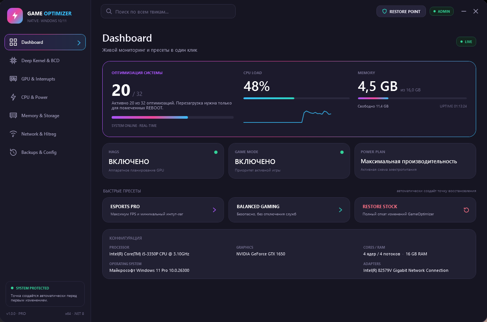
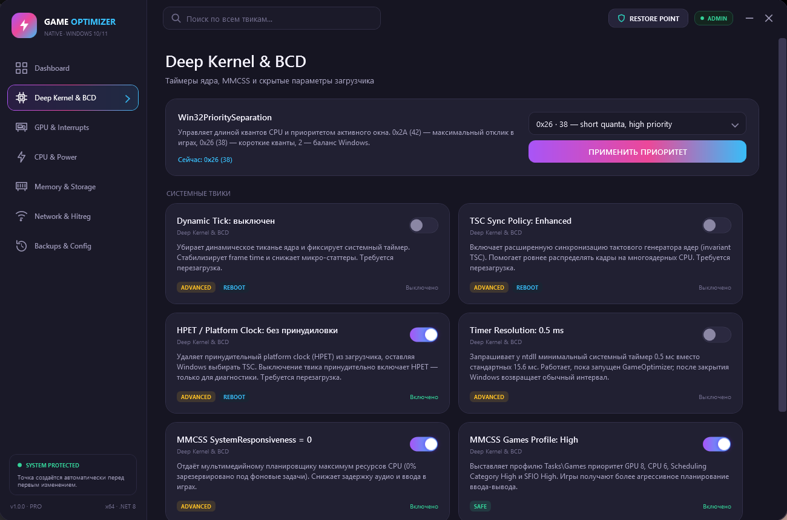
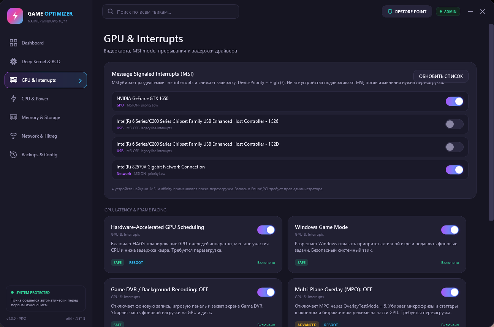
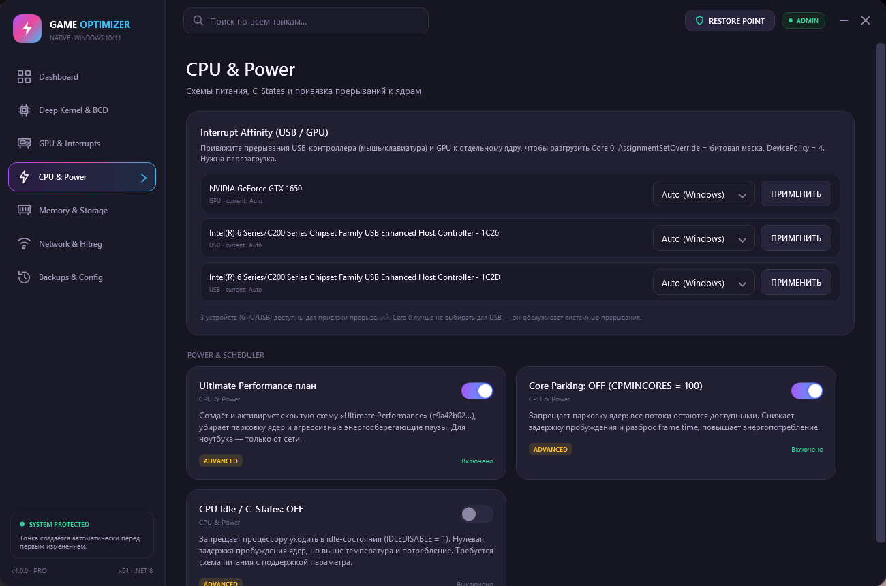
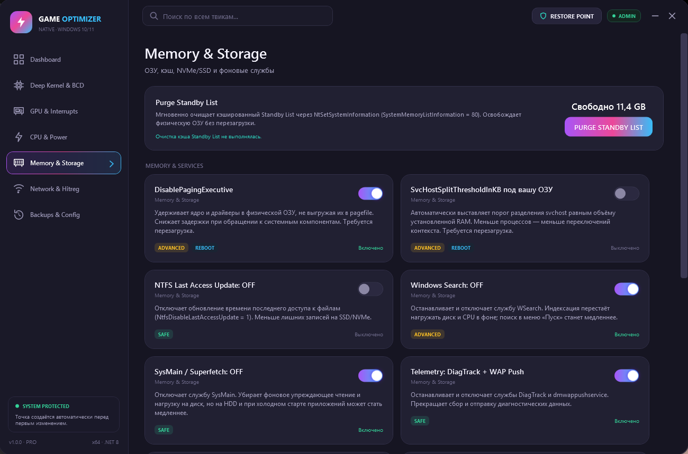
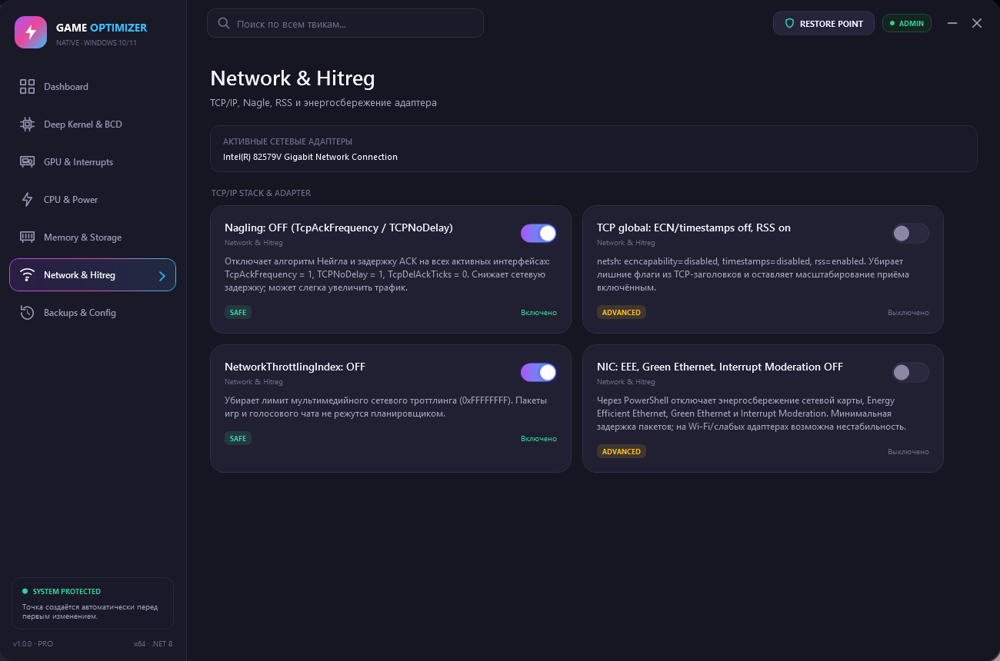
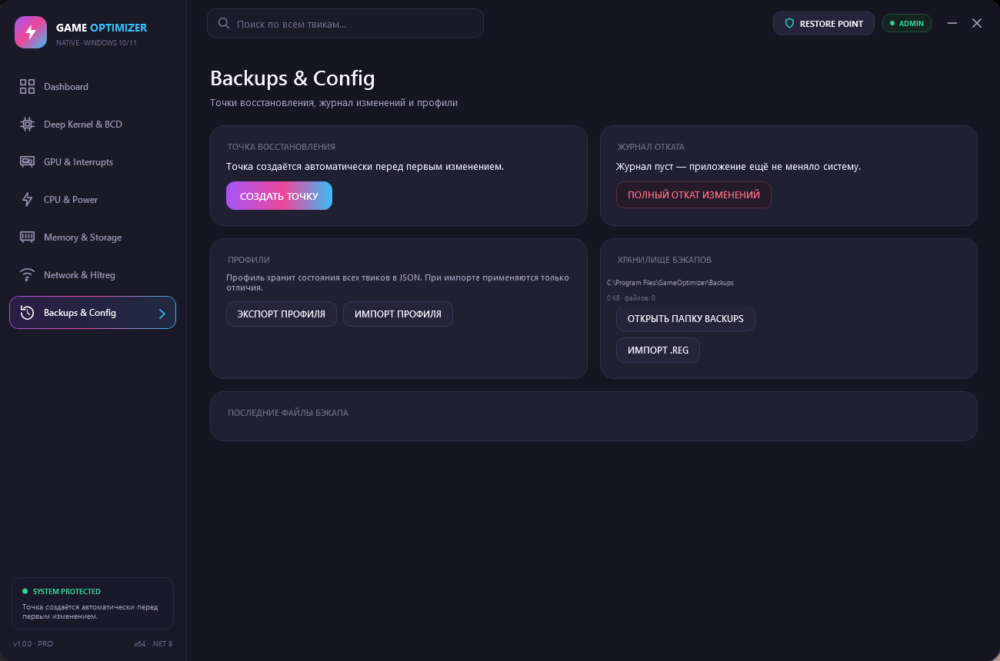
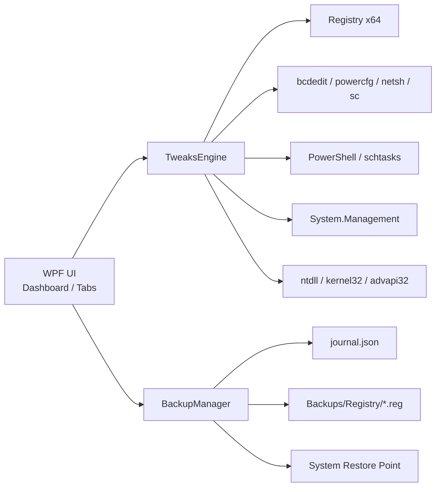

# GameOptimizer


Нативный десктопный оптимизатор Windows 10/11 для гейминга: таймеры ядра, BCD, MMCSS,
GPU/прерывания, электропитание, память, NVMe и сеть. Написан на **C# / .NET 8 WPF**
без сторонних UI-библиотек, собирается в **один self-contained `.exe`** с манифестом
`requireAdministrator`.

> **Готовый `GameOptimizer.exe` уже лежит в корне этой папки.** Его можно запускать сразу,
> без сборки и установки .NET. Ниже — инструкции для пересборки из исходников.

> Native Windows 10/11 gaming optimizer built with C# and .NET 8 WPF. Single-file
> self-contained executable, UAC admin manifest, System Restore point and a precise
> reversible registry/BCD/service journal.



## Возможности

### Dashboard
- Живой мониторинг CPU, RAM, uptime, HAGS, Game Mode и активной схемы питания.
- Пресеты в один клик: **Esports Pro**, **Balanced Gaming**, **Restore Stock**.
- Сводка по количеству активных оптимизаций и конфигурации ПК.

### Deep Kernel & BCD
- `bcdedit /set disabledynamictick yes`
- удаление принудительного `useplatformclock` (HPET / platform clock)
- `bcdedit /set tscsyncpolicy Enhanced`
- Win32PrioritySeparation: `0x26` / `0x2A` / Windows default
- MMCSS `SystemResponsiveness = 0`, профиль `Tasks\Games` (GPU Priority 8, Priority 6, High)
- Timer Resolution 0.5 ms через `NtSetTimerResolution`
- отключение Spectre/Meltdown-митигаций (`FeatureSettingsOverride`) — **RISKY**, с подтверждением

### GPU & Interrupts
- сканирование `HKLM\SYSTEM\CurrentControlSet\Enum\PCI` (GPU / USB / NIC)
- MSI mode: `MSISupported = 1`, `DevicePriority = High (3)`
- HAGS (`HwSchMode`), Game Mode, Game DVR
- Multi-Plane Overlay (`OverlayTestMode = 5`), TDR delay 10 s
- NVIDIA Telemetry / HDCP, AMD ULPS (показываются только для найденного вендора)

### CPU & Power
- активация скрытой схемы **Ultimate Performance** (`e9a42b02-…`)
- отключение парковки ядер (`CPMINCORES = 100`) и C-States (`IDLEDISABLE = 1`)
- Interrupt Affinity для USB/GPU через `AssignmentSetOverride` (битовая маска ядра)

### Memory & Storage
- `DisablePagingExecutive`
- автоматический `SvcHostSplitThresholdInKB` под реальный объём RAM
- очистка Standby List через `NtSetSystemInformation`
- NTFS Last Access, Windows Search, SysMain, телеметрия, Xbox, MapsBroker, Print Spooler
- отключение фоновых UWP-приложений

### Network & Hitreg
- Nagle off на всех активных интерфейсах: `TcpAckFrequency`, `TCPNoDelay`, `TcpDelAckTicks`
- `netsh int tcp set global`: ECN/timestamps off, RSS on
- `NetworkThrottlingIndex = 0xFFFFFFFF`
- EEE / Green Ethernet / Interrupt Moderation / NIC power management через PowerShell

### Безопасность и откат
- попытка создать точку восстановления **перед первым изменением** (WMI `SystemRestore`)
- экспорт затрагиваемых веток реестра в `Backups\Registry\*.reg`
- точный журнал изменений реестра, BCD и служб (старое значение/тип/наличие)
- **полный откат в один клик** + импорт `.reg`
- экспорт/импорт профилей `.json`
- рискованные твики помечены `RISKY` и требуют подтверждения

## Скриншоты

| Deep Kernel & BCD | GPU & Interrupts |
|---|---|
|  |  |

| CPU & Power | Memory & Storage |
|---|---|
|  |  |

| Network & Hitreg | Backups & Config |
|---|---|
|  |  |

## Архитектура



Все операции чтения состояния выполняются при старте: переключатели сразу показывают,
что уже включено в системе, а не хранят локальные «настройки по умолчанию».

## Структура проекта

```text
.
├── GameOptimizer.exe          # готовый self-contained single-file (Windows 10/11 x64)
├── Optimizer.csproj           # net8.0-windows, WPF, single-file publish
├── app.manifest               # requireAdministrator + PerMonitorV2 DPI
├── App.xaml / App.xaml.cs     # палитра, стили, шаблоны, single-instance mutex
├── MainWindow.xaml / .cs      # окно, навигация, поиск, мониторинг, пресеты
├── TweaksEngine.cs            # реестр, BCD, powercfg, netsh, службы, WMI, P/Invoke
├── BackupManager.cs           # restore point, журнал, .reg, профили .json
├── Models.cs                  # TweakItem, команды, конвертеры, PCI/affinity модели
├── build.ps1                  # пересборка single-file exe прямо в корень папки
├── .github/workflows/         # CI: сборка и artifact GameOptimizer.exe
└── docs/screenshots/          # скриншоты для README
```

## Сборка

Нужен **.NET SDK 8.0.x x64** и Windows 10/11 x64.

```powershell
git clone https://github.com/<USER>/<REPO>.git
cd <REPO>
.\build.ps1
```

Или вручную:

```powershell
dotnet publish .\Optimizer.csproj -c Release -r win-x64 --self-contained true -p:PublishSingleFile=true -p:IncludeNativeLibrariesForSelfExtract=true -p:EnableCompressionInSingleFile=true -p:DebugType=None -p:DebugSymbols=false -o .
```

Результат: `.\GameOptimizer.exe` — **один файл** (~66 МБ), без установки .NET на целевой
машине. При запуске Windows запросит права администратора.

> `PublishSingleFile` для WPF распаковывает native-библиотеки во временную папку при старте —
> это нормальное поведение. `Backups` всегда создаётся рядом с `.exe` (используется
> `Environment.ProcessPath`, а не temp-папка распаковки).

## GitHub Actions

Workflow `.github/workflows/build.yml` собирает проект на `windows-latest` при push/PR
и выкладывает `GameOptimizer.exe` в artifact **GameOptimizer-win-x64**. В самой папке
готовый `.exe` уже лежит в корне; при желании его же можно приложить к GitHub Release.

## Публикация на GitHub

```bash
git init
git add .
git commit -m "Initial commit: GameOptimizer"
git branch -M main
git remote add origin https://github.com/<USER>/<REPO>.git
git push -u origin main
```

Для релиза:

```bash
git tag v1.0.0
git push origin v1.0.0
```

Затем прикрепите `GameOptimizer.exe` из корня папки (или artifact из Actions) к GitHub Release.

## Ограничения и предостережения

- Создание точки восстановления зависит от включённой «Защиты системы» и работоспособности
  VSS. Если точка не создалась, приложение предупредит и предложит продолжить с журналом
  изменений.
- Отключение Spectre/Meltdown-митигаций, Print Spooler, Xbox-служб, телеметрии и
  энергосбережения NIC — осознанный компромисс между производительностью, безопасностью и
  функциональностью. Все такие пункты помечены.
- NVIDIA/AMD-твики отображаются только при наличии соответствующей видеокарты.
- Запись в `Enum\PCI` (MSI/affinity) может быть запрещена ACL даже администратору;
  приложение вернёт понятную ошибку.
- Некоторые твики применяются только после перезагрузки (бейдж `REBOOT`).
- Антивирусы иногда эвристически реагируют на утилиты, меняющие BCD/службы/реестр.
  Перед использованием на рабочей машине проверьте сборку в VM.

## Лицензия

Файл `LICENSE` намеренно не добавлен. Если планируете открыть исходники — добавьте
MIT/Apache-2.0 (или другую) лицензию перед публикацией.
